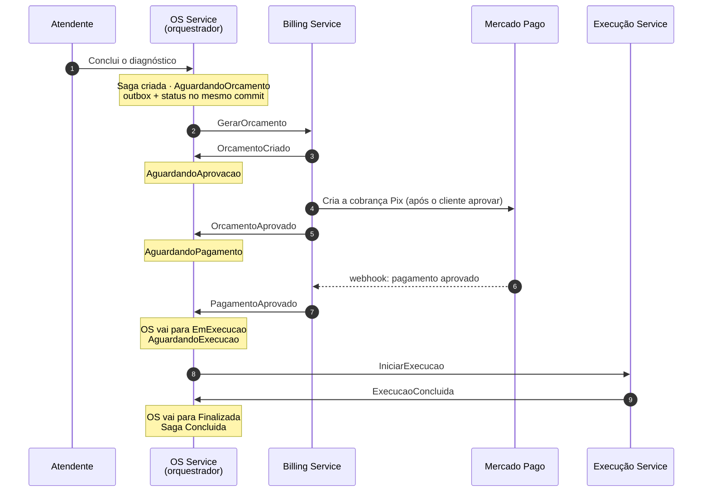
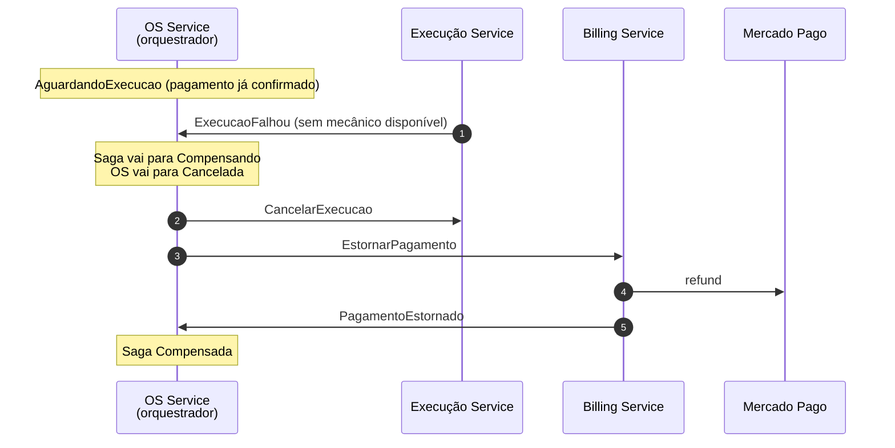

# Saga da Ordem de Serviço

Como o fluxo de uma ordem de serviço atravessa os três microsserviços da Fase 4, o que acontece
quando uma etapa falha e onde cada peça mora no código.

A justificativa da escolha — orquestrada, SNS/SQS, outbox — está no
[ADR 007](./adrs/ADR%20007%20-%20Saga%20Orquestrada.md).

---

## Por que uma Saga

A Fase 4 quebra a aplicação em três serviços com bancos próprios:

| Serviço | Banco | Responsabilidade |
|---|---|---|
| **OS Service** (este repositório) | PostgreSQL `wrench_os` | Ciclo de vida da OS, autenticação, cadastro e estoque |
| **Billing Service** | PostgreSQL `wrench_billing` | Orçamento, aprovação, cobrança Pix e estorno no Mercado Pago |
| **Execução Service** | DynamoDB | Fila de execução, diagnóstico e reparo |

Abrir uma OS deixou de ser uma transação: ela atravessa três bancos, e nenhum serviço pode ler o
banco do outro. A Saga é o que substitui o `ROLLBACK` que não existe mais — cada etapa concluída
tem uma ação que a desfaz, e o orquestrador decide quando acioná-la.

**A estratégia é orquestrada**, com o orquestrador dentro do OS Service: a OS já é dona do ciclo
de vida, então o estado da Saga e o status da ordem mudam na mesma transação e as compensações
ficam em um lugar só, explícitas e testáveis.

---

## Fluxo feliz



### Estados da Saga

```
AguardandoOrcamento ──▶ AguardandoAprovacao ──▶ AguardandoPagamento ──▶ AguardandoExecucao ──▶ Concluida
        │                       │                       │                       │
        └───────────────────────┴───────────────────────┴───────────────────────┘
                                            │
                              falha ou timeout da etapa
                                            │
                        ┌───────────────────┴───────────────────┐
                        ▼                                       ▼
                  Compensada                             Compensando ──▶ Compensada
            (nada foi cobrado)                      (aguardando o estorno)  │
                                                                            ▼
                                                                         Falha
                                                           (estorno não voltou: manual)
```

---

## Compensações

| Etapa que falha | Evento ou timeout | O que o orquestrador emite | Status final da OS | Estado da Saga |
|---|---|---|---|---|
| Geração do orçamento | `OrcamentoFalhou` | nada | `EmDiagnostico` | `Compensada` |
| Aprovação do cliente | `OrcamentoRecusado` | `CancelarOrcamento` | `Cancelada` | `Compensada` |
| Pagamento | `PagamentoFalhou` | `CancelarOrcamento` | `Cancelada` | `Compensada` |
| Execução | `ExecucaoFalhou` | `CancelarExecucao` + `EstornarPagamento` | `Cancelada` | `Compensando` → `Compensada` |
| Estorno | `EstornoFalhou` ou timeout | nada | `Cancelada` | `Falha` |

A falha ao gerar o orçamento é a única que **não** cancela a ordem de serviço: nada foi prometido
ao cliente nem cobrado, então a OS volta para `EmDiagnostico` e o atendente tenta de novo.

**Timeout aplica a mesma compensação da falha.** Um serviço que nunca responde não pode deixar a
OS presa; `SagaTimeoutWorker` varre as Sagas com prazo vencido e aciona a compensação da etapa.



---

## Mensagens

Os contratos vivem no pacote versionado
[`Wrench.Contracts`](https://github.com/euthribeiro/wrench-contracts) (linha 1.x, mudanças apenas
aditivas). Toda mensagem carrega `ordemServicoId` e `correlationId`.

### Publicadas (tópico `wrench-os-events`)

| Tipo | Destino | Quando |
|---|---|---|
| `GerarOrcamento` | Billing | O diagnóstico foi concluído |
| `CancelarOrcamento` | Billing | Compensação de recusa ou falha de pagamento |
| `EstornarPagamento` | Billing | Compensação depois de a cobrança ter sido paga |
| `IniciarExecucao` | Execução | O pagamento foi confirmado |
| `CancelarExecucao` | Execução | Compensação da etapa de execução |

### Consumidas (fila `wrench-os-saga`)

| Tipo | Origem | Efeito |
|---|---|---|
| `OrcamentoCriado` | Billing | `AguardandoAprovacao` |
| `OrcamentoFalhou` | Billing | Compensa: OS volta para `EmDiagnostico` |
| `OrcamentoAprovado` | Billing | `AguardandoPagamento` |
| `OrcamentoRecusado` | Billing | Compensa: OS `Cancelada` |
| `PagamentoAprovado` | Billing | Aprova a OS, emite `IniciarExecucao` |
| `PagamentoFalhou` | Billing | Compensa: OS `Cancelada` |
| `PagamentoEstornado` | Billing | Fecha a compensação |
| `EstornoFalhou` | Billing | Saga em `Falha` |
| `ExecucaoConcluida` | Execução | OS `Finalizada`, Saga `Concluida` |
| `ExecucaoFalhou` | Execução | Compensa: estorno e saída da fila |

### Atributos de mensagem

O corpo é o JSON do contrato (`camelCase`), publicado com `raw_message_delivery`. Os metadados
viajam como message attributes:

| Atributo | Para quê |
|---|---|
| `messageId` | Id da linha no outbox do publicador; base da idempotência do consumidor |
| `tipo` | Nome do contrato; é o que o **filter policy** da assinatura SNS avalia |
| `correlationId` | Correlação da OS, propagada do header `X-Correlation-ID` |
| `traceparent` | Contexto W3C do trace, que mantém o rastro distribuído no New Relic |

---

## Consistência

### Outbox transacional

Mudar o estado no Postgres e publicar no SNS podem falhar de forma independente. O orquestrador
grava a mensagem de saída na tabela `SagaOutbox` **no mesmo `OrdemServicoDbContext`** que grava o
estado da Saga e o status da OS: um único `CommitAsync` cobre os três.

O `OutboxDispatcher` publica as pendentes a cada 2 segundos e as marca como publicadas. Uma falha
de publicação mantém a mensagem pendente — **entrega ao menos uma vez**.

### Inbox e idempotência

O consumidor grava o `messageId` em `SagaInbox` **na mesma transação** da mudança de estado. Uma
entrega repetida encontra o registro e é descartada. Além disso, a máquina de estados recusa
transições inválidas ou repetidas devolvendo `false`, então mesmo sem o inbox uma mensagem
duplicada não corromperia o estado.

### DLQ

Esgotadas as 5 entregas, o SQS move a mensagem para `wrench-os-saga-dlq` e o alerta **DLQ da Saga
com mensagens** abre incidente no New Relic.

---

## Onde está no código

| Camada | Caminho | O que tem |
|---|---|---|
| Domínio | `src/.../ordem.servico.domain/Saga` | `SagaOrdemServico` (máquina de estados), `SagaEstado`, `SagaEtapa`, `SagaTransicao`, `SagaOptions`, `SagaMetrics`, portas e contratos |
| Aplicação | `src/.../ordem.servico.application/Saga` | `SagaOrquestrador`: traduz mensagem em transição, status da OS e comandos de saída |
| Infraestrutura | `src/.../ordem.servico.infra/Saga` | `SagaOrdemServicoRepository`, `OutboxSaga`, `InboxSaga` e, em `Mensageria/`, `SnsPublicadorSaga`, `SqsSagaConsumer`, `ConversorMensagemSqs`, `PublicacaoOutbox`, `OutboxDispatcher`, `SagaTimeoutWorker` |
| Banco | `src/.../ordem.servico.infra/Migrations` | `SagaOrdemServico`, `SagaTransicao`, `SagaOutbox`, `SagaInbox` |

A Saga nasce em `DiagnosticoCommandHandler.Handle(RealizarDiagnosticoCommand)`, logo antes do
`CommitAsync` que persiste o diagnóstico.

---

## Configuração

| Variável | Padrão | Para quê |
|---|---|---|
| `Sns__TopicArn` | — | Tópico `wrench-os-events` (output `os_topic_arn` do stack `mensageria`) |
| `Sqs__QueueUrl` | — | Fila `wrench-os-saga` (output `os_queue_url`). **Vazia desliga o consumidor**, o que permite rodar a API local sem mensageria |
| `Sqs__TentativasAteDlq` | `5` | A partir daqui a mensagem é contabilizada como destinada à DLQ |
| `Outbox__IntervaloSegundos` | `2` | Ritmo do dispatcher |
| `Outbox__TamanhoLote` | `25` | Mensagens por rodada |
| `Saga__PrazoOrcamentoMinutos` | `15` | Espera pelo `OrcamentoCriado` |
| `Saga__PrazoAprovacaoMinutos` | `2880` | Espera pela decisão do cliente (2 dias) |
| `Saga__PrazoPagamentoMinutos` | `60` | Espera pelo webhook do pagamento |
| `Saga__PrazoExecucaoMinutos` | `2880` | Espera pelo fim do reparo (2 dias) |
| `Saga__PrazoEstornoMinutos` | `60` | Espera pelo estorno antes de marcar `Falha` |
| `Saga__IntervaloVerificacaoSegundos` | `30` | Ritmo da varredura de timeouts |

No deploy, o chart recebe `saga.snsTopicArn`, `saga.sqsQueueUrl` e `serviceAccount.roleArn` a
partir dos outputs do stack `terraform/mensageria` do `infra-k8s`.

---

## Observabilidade

A Saga publica no meter `Wrench.Saga` e abre um span por mensagem na `ActivitySource`
`Wrench.Saga`, ligado ao trace de quem publicou pelo `traceparent`. Tudo sai por OpenTelemetry
para o New Relic.

| Métrica | Tipo | Alerta correspondente |
|---|---|---|
| `saga.iniciada` | contador | — |
| `saga.concluida` | contador | — |
| `saga.compensacao` (por `etapa`) | contador | — |
| `saga.timeout` (por `estado`) | contador | Etapa da Saga expirou por timeout |
| `saga.mensagem.recebida` (por `tipo`) | contador | — |
| `saga.mensagem.falha` (por `tipo`) | contador | Falha no consumo de mensagem da Saga |
| `saga.mensagem.dlq` (por `tipo`) | contador | DLQ da Saga com mensagens |
| `saga.mensagem.publicada` (por `tipo`) | contador | — |
| `saga.outbox.pendentes` | gauge | Outbox da Saga represado |
| `saga.duracao` | histograma (ms) | Saga demorando a fechar |

A página **Saga** do dashboard `Wrench Auto Repair` e as condições de alerta são provisionadas em
`infra-k8s/terraform/observability`.

---

## Como testar

```bash
# Máquina de estados, compensações e timeouts
dotnet test tests/wrench.auto.repair.ordem.servico.domain.tests

# Orquestrador, persistência do outbox/inbox e transporte
dotnet test tests/wrench.auto.repair.ordem.servico.application.tests
```

Os testes do orquestrador cobrem o caminho feliz, cada compensação, o timeout de cada etapa, a
mensagem repetida, a mensagem fora de ordem e a mensagem para uma Saga que ainda não existe.

Para a demonstração da compensação, o `execucao-service` expõe
`POST /api/v1/execucoes/{id}/falhar`, habilitado por `Execucao__PermitirFalhaForcada`, que publica
`ExecucaoFalhou` e dispara o estorno de ponta a ponta.
